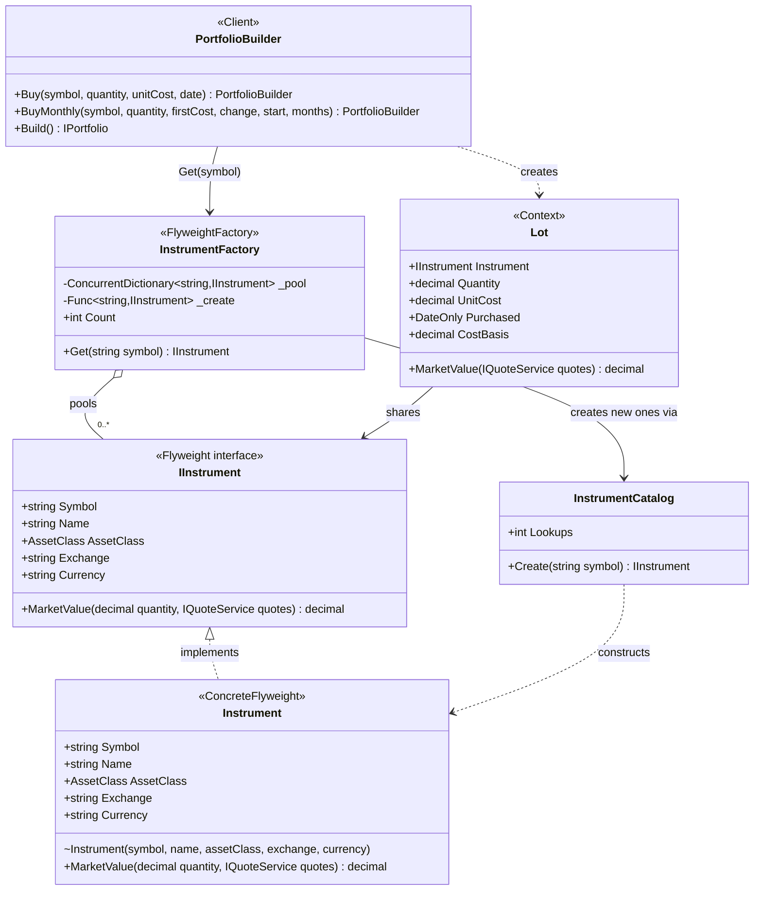
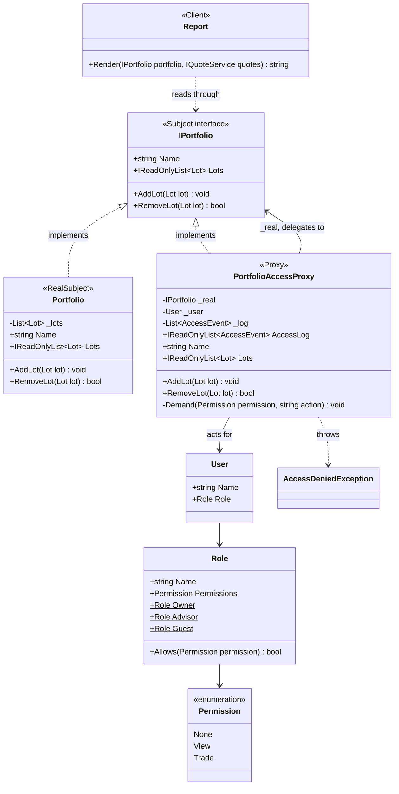
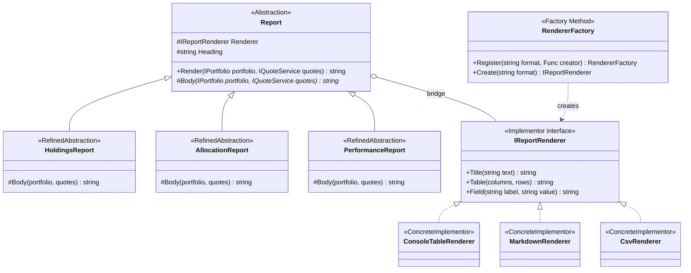
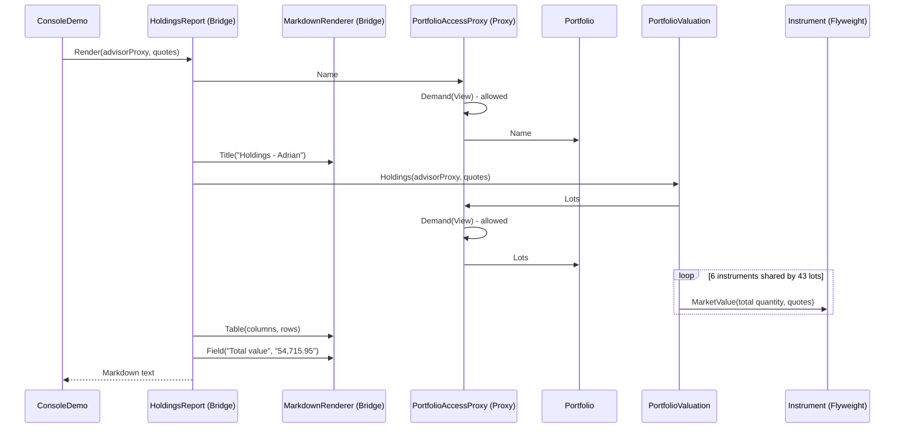

# Laboratory Work No. 3 — Structural Design Patterns

**Student:** Adrian Mutu, group FAF-242
**Course:** Software Design Techniques and Mechanisms (TMPS) — FCIM, Technical University of Moldova
**Checked by:** Daniel Istrati
**Implementation:** C# 14 on .NET 10 · tests: xUnit v3 · code: [`src/WealthTracker`](src/WealthTracker)

## 1. Domain description

The project continues the **Personal Wealth Dashboard & Multi-Asset Portfolio Tracker** from Laboratory Works 1 and 2. It records a person's investments — stocks, ETFs, cryptocurrencies and cash — as dated **purchase lots** (what was bought, how much, at what price, when), values them at current market prices and produces holdings, allocation and performance reports.

Lab 3 adds three capabilities a real user of such a dashboard needs. Each one is a design problem that a structural pattern solves:

| Need | Why it is a problem without a pattern | Pattern |
|---|---|---|
| A monthly ETF savings plan buys VWCE every month, so one instrument appears in dozens or hundreds of lots | every lot would carry its own copy of the instrument's name, exchange, currency and asset class | **Flyweight** |
| Share the portfolio with a financial advisor who may look but must not trade | the portfolio would have to know about users and roles, and every caller would have to check them | **Proxy** |
| Show the same reports in the terminal, as Markdown for GitHub and as CSV for a spreadsheet | one class per report-and-format pair: 3 reports × 3 formats = 9 classes, growing multiplicatively | **Bridge** |

Labs 1–2 were written in Python, which this assignment forbids, so the domain was ported to C#. The creational patterns of Lab 2 are reused to create the objects the structural patterns work with: a **Builder** with a **Director** creates portfolios, and a parameterised **Factory Method** creates renderers (§4).

### Requirements checklist

| Requirement | Where it is met |
|---|---|
| 1. Three structural patterns with full structure | Flyweight §2.1, Proxy §2.2, Bridge §2.3 — every GoF role is present |
| 2. Patterns interact | §3: one call goes Proxy → Bridge → Flyweight; covered by `InteractionTests` |
| 3. Client depends on abstractions | `ConsoleDemo` uses `IPortfolio`, `Report`, `IReportRenderer`, `IQuoteService` |
| 4. Open for extension | a new role, renderer, report or format needs new classes or data only — proven by `NewRole_…`, `NewRenderer_…`, `NewReport_…`, `RendererFactory_NewFormat_…` |
| 5. Build on the previous lab | Builder, Director and Factory Method reused (§4) |
| 6. Clean project structure | separate `Domain/`, `Patterns/<Pattern>/`, `Creational/`, `Client/` folders (§5) |
| 7. Runnable demo | `dotnet run --project src/WealthTracker` — output in [`docs/demo-output.txt`](docs/demo-output.txt); `-- shell` shows the Flyweight and the Proxy live (§5) |
| B. At least 2 tests per pattern | Flyweight 7, Proxy 6, Bridge 11 (7 methods), plus 4 interaction and 4 creational — 32 in total, `dotnet test` |

## 2. Patterns

### 2.1 Flyweight — shared instrument data

**Problem.** A lot needs to know its instrument's symbol, name, asset class, exchange and currency. This *intrinsic* data is identical for every lot of the same instrument and never changes, whereas quantity, price paid and date are different for every lot (*extrinsic*). The demo portfolio holds 43 lots of only 6 instruments, 36 of them VWCE from a three-year monthly savings plan; a real brokerage history easily has thousands. Without sharing, each lot would own a copy of the reference data.

**Roles.** `IInstrument` is the **Flyweight** — it exposes the intrinsic state and takes extrinsic state as a parameter (`MarketValue(quantity, quotes)`). `Instrument` is the **ConcreteFlyweight**: immutable, with an internal constructor so clients cannot create it with `new`. `InstrumentFactory` is the **FlyweightFactory**: a pool with lookup-or-create. `Lot` is the **context** that stores the extrinsic state plus a reference to the shared flyweight. `PortfolioBuilder` is the **client** that asks the factory for instruments. `InstrumentCatalog` is the reference-data source the factory creates new flyweights from.

<!-- figure: flyweight -->

*Figure 1 — Flyweight in the project: many `Lot` contexts share one `Instrument` per symbol.*

**Code** — [`InstrumentFactory.cs`, lines 10–33](src/WealthTracker/Patterns/Flyweight/InstrumentFactory.cs#L10-L33):

```csharp
public sealed class InstrumentFactory
{
    private readonly ConcurrentDictionary<string, IInstrument> _pool = new(StringComparer.OrdinalIgnoreCase);

    // Created once. Passing the method group `catalog.Create` straight to
    // GetOrAdd would allocate a new delegate on every lookup - which cost more
    // memory than the shared instruments saved.
    private readonly Func<string, IInstrument> _create;

    public InstrumentFactory(InstrumentCatalog catalog)
    {
        _create = catalog.Create;
    }

    /// <summary>Number of distinct instruments created so far.</summary>
    public int Count => _pool.Count;

    public IInstrument Get(string symbol)
    {
        // Lookup-or-create. GetOrAdd is thread-safe: even if two threads race on
        // a new symbol, both receive the single instance that ends up stored.
        return _pool.GetOrAdd(symbol, _create);
    }
}
```

`GetOrAdd` returns the pooled instrument when the symbol is already known and calls the catalog only on the first request, so all 36 VWCE lots reference the same object. Sharing is safe because `Instrument` has only get-only properties set in an internal constructor: no lot can change data that the others see.

**Measurement.** [`FlyweightMeasurement`](src/WealthTracker/Client/FlyweightMeasurement.cs) allocates 100,000 lots twice and compares the bytes allocated:

| 100,000 lots over 6 instruments | Instrument objects | Bytes allocated |
|---|---:|---:|
| unshared — a new instrument per lot | 100,000 | 12,800,024 |
| shared through `InstrumentFactory` | 6 | 7,200,648 |
| **saved** | | **5,599,376 (43.7%)** |

The first measurement showed the opposite — sharing used 6% *more* memory — which led to a real bug (§7).

**Tests.** [`FlyweightTests.cs`](tests/WealthTracker.Tests/FlyweightTests.cs)

| Test | What it proves |
|---|---|
| `Get_SameSymbolTwice_ReturnsTheSameInstance` | two requests for the same symbol (in any letter case) return the *same object*; the pool holds one entry |
| `TenThousandLots_ShareOneInstrumentPerSymbol` | 10,000 lots over 3 symbols create exactly 3 instruments, and the catalog is read only 3 times |
| `Instrument_IntrinsicStateIsImmutable` | via reflection: `Instrument` has no setters and only `readonly` fields, so shared state cannot change |
| `MarketValue_TakesQuantityAsExtrinsicState` | two lots share one BTC instrument but are valued at their own quantities (12,250.00 and 9,187.50) |
| `Get_FromManyThreadsAtOnce_StillCreatesOneInstance` | 1,000 parallel requests for a new symbol all receive a single instance |
| `SharingInstruments_AllocatesLessThanOneInstrumentPerLot` | measured: sharing saves more than 30% of allocations (regression test for the bug in §7) |
| `Get_UnknownSymbol_Throws` | an unknown symbol is rejected and nothing is added to the pool |

Log of `dotnet test --output Detailed` for `FlyweightTests` (full log: [`docs/test-results.txt`](docs/test-results.txt)):

```text
passed FlyweightTests.MarketValue_TakesQuantityAsExtrinsicState (9ms)
passed FlyweightTests.SharingInstruments_AllocatesLessThanOneInstrumentPerLot (6ms)
passed FlyweightTests.TenThousandLots_ShareOneInstrumentPerSymbol (5ms)
passed FlyweightTests.Get_SameSymbolTwice_ReturnsTheSameInstance (0ms)
passed FlyweightTests.Get_UnknownSymbol_Throws (0ms)
passed FlyweightTests.Instrument_IntrinsicStateIsImmutable (0ms)
passed FlyweightTests.Get_FromManyThreadsAtOnce_StillCreatesOneInstance (2ms)
7 passed, 0 failed
```

### 2.2 Proxy — controlled access to a shared portfolio

**Problem.** The owner wants a financial advisor to see the portfolio, but only the owner may buy or sell; a guest link should show nothing. Putting role checks inside `Portfolio` would mix two responsibilities, and leaving them to callers would let any forgotten check through. The checks must sit *in front of* the portfolio, without the reports that read it having to change.

**Roles.** `IPortfolio` is the **Subject**; `Portfolio` is the **RealSubject**; `PortfolioAccessProxy` is the **Proxy** — a *protection proxy* that implements the same interface, holds a reference to the real portfolio and checks the user's `Role` before every call. Roles are data (`Role` = name + `Permission` flags), so the proxy never changes when a role is added. Clients — the reports and the demo — see only `IPortfolio`.

<!-- figure: proxy -->

*Figure 2 — Proxy in the project: the proxy and the real portfolio share the `IPortfolio` interface.*

**Code** — [`PortfolioAccessProxy.cs`, lines 45–65](src/WealthTracker/Patterns/Proxy/PortfolioAccessProxy.cs#L45-L65):

```csharp
    public void AddLot(Lot lot)
    {
        ArgumentNullException.ThrowIfNull(lot);
        Demand(Permission.Trade, $"buy {lot.Quantity} {lot.Instrument.Symbol}");
        _real.AddLot(lot);
    }

    public bool RemoveLot(Lot lot)
    {
        ArgumentNullException.ThrowIfNull(lot);
        Demand(Permission.Trade, $"sell {lot.Quantity} {lot.Instrument.Symbol}");
        return _real.RemoveLot(lot);
    }

    private void Demand(Permission permission, string action)
    {
        var allowed = _user.Role.Allows(permission);
        _log.Add(new AccessEvent(_user.Name, action, allowed));
        if (!allowed)
            throw new AccessDeniedException(_user, action);
    }
```

`Demand` runs *before* delegation: if the role lacks the permission it records the attempt and throws, so `_real` is never touched; otherwise the call is forwarded with the same arguments and the real result is returned unchanged. Unlike a Decorator, the proxy adds no behaviour to an allowed call — it only decides whether the call happens.

**Tests.** [`ProxyTests.cs`](tests/WealthTracker.Tests/ProxyTests.cs) — a `SpyPortfolio` stub counts the calls that actually reach the real subject.

| Test | What it proves |
|---|---|
| `Advisor_AddLot_IsBlocked_AndNeverReachesTheRealPortfolio` | an advisor's purchase throws `AccessDeniedException` and the stub records **0** writes |
| `Owner_AddLot_PassesTheSameLotThroughUnchanged` | the owner's call reaches the real portfolio once, with the *same* `Lot` instance |
| `Advisor_Lots_ReturnsExactlyWhatTheRealPortfolioReturns` | an allowed read returns the real subject's result unchanged (same object) |
| `Guest_CannotEvenView` | a guest is denied reads too, and the stub records **0** reads |
| `EveryAttempt_IsRecordedInTheAccessLog` | allowed and denied attempts are both logged, in order |
| `NewRole_WorksWithoutChangingTheProxy` | an "Auditor" role created at run time can read but not sell — no class was edited |

Log of `dotnet test --output Detailed` for `ProxyTests` (full log: [`docs/test-results.txt`](docs/test-results.txt)):

```text
passed ProxyTests.Advisor_Lots_ReturnsExactlyWhatTheRealPortfolioReturns (9ms)
passed ProxyTests.Owner_AddLot_PassesTheSameLotThroughUnchanged (5ms)
passed ProxyTests.EveryAttempt_IsRecordedInTheAccessLog (2ms)
passed ProxyTests.Advisor_AddLot_IsBlocked_AndNeverReachesTheRealPortfolio (0ms)
passed ProxyTests.Guest_CannotEvenView (0ms)
passed ProxyTests.NewRole_WorksWithoutChangingTheProxy (0ms)
6 passed, 0 failed
```

### 2.3 Bridge — reports × output formats

**Problem.** Reports differ in *what* they show (holdings, allocation, performance) and output formats differ in *how* they draw it (an aligned console table, a Markdown table, RFC 4180 CSV). Combining both in one hierarchy needs a class for every pair — `MarkdownHoldingsReport`, `CsvHoldingsReport`, … — nine classes today, and every new report or format multiplies the count.

**Roles.** `Report` is the **Abstraction**: it holds an `IReportRenderer` (the bridge) and fixes the overall layout in `Render`. `HoldingsReport`, `AllocationReport` and `PerformanceReport` are **RefinedAbstractions** that decide the content. `IReportRenderer` is the **Implementor**, with three primitives — `Title`, `Table`, `Field`. `ConsoleTableRenderer`, `MarkdownRenderer` and `CsvRenderer` are **ConcreteImplementors**. Both sides have three classes; nine combinations come from six classes. Renderers are created by `RendererFactory` (§4).

<!-- figure: bridge -->

*Figure 3 — Bridge in the project: the report hierarchy and the renderer hierarchy vary independently.*

**Code** — [`Report.cs`, lines 11–27](src/WealthTracker/Patterns/Bridge/Report.cs#L11-L27):

```csharp
public abstract class Report
{
    protected Report(IReportRenderer renderer)
    {
        Renderer = renderer ?? throw new ArgumentNullException(nameof(renderer));
    }

    /// <summary>The bridge to the implementation side.</summary>
    protected IReportRenderer Renderer { get; }

    protected abstract string Heading { get; }

    public string Render(IPortfolio portfolio, IQuoteService quotes) =>
        Renderer.Title($"{Heading} - {portfolio.Name}") + Body(portfolio, quotes);

    protected abstract string Body(IPortfolio portfolio, IQuoteService quotes);
}
```

`Report` never draws anything itself: `Render` and every subclass's `Body` express the report through the renderer's three primitives — for example `HoldingsReport` ends with `Renderer.Table(columns, rows) + Renderer.Field("Total value", …)`. Because the abstraction only knows `IReportRenderer`, a new format works with every existing report and a new report works with every existing format.

**Tests.** [`BridgeTests.cs`](tests/WealthTracker.Tests/BridgeTests.cs) — a test-only `RecordingRenderer` and a test-only `LotCountReport` extend each side without touching the other.

| Test | What it proves |
|---|---|
| `HoldingsReport_ShowsTheSameTotal_InEveryFormat` (×3) | one report rendered by each of the three renderers contains the same total, 54,715.95 |
| `NewRenderer_WorksWithEveryReport_WithoutChangingThem` | a renderer written only in the test drives all three reports |
| `NewReport_WorksWithEveryRenderer_WithoutChangingThem` (×3) | a report written only in the test works with all three renderers |
| `HoldingsReport_AggregatesLotsPerInstrument` | 43 lots become a 6-row table — one row per shared instrument |
| `CsvRenderer_QuotesFieldsContainingCommas` | RFC 4180: fields with commas or quotes are quoted and quotes doubled |
| `MarkdownRenderer_RightAlignsNumericColumns` | numeric columns get `---:` alignment |
| `PerformanceReport_ComputesTheReturnOnCost` | invested 41,856.80, return 30.72% |

Log of `dotnet test --output Detailed` for `BridgeTests` (full log: [`docs/test-results.txt`](docs/test-results.txt)):

```text
passed BridgeTests.HoldingsReport_AggregatesLotsPerInstrument (13ms)
passed BridgeTests.PerformanceReport_ComputesTheReturnOnCost (7ms)
passed BridgeTests.HoldingsReport_ShowsTheSameTotal_InEveryFormat(renderer: ConsoleTableRenderer { }) (2ms)
passed BridgeTests.HoldingsReport_ShowsTheSameTotal_InEveryFormat(renderer: MarkdownRenderer { }) (0ms)
passed BridgeTests.HoldingsReport_ShowsTheSameTotal_InEveryFormat(renderer: CsvRenderer { }) (0ms)
passed BridgeTests.NewReport_WorksWithEveryRenderer_WithoutChangingThem(renderer: ConsoleTableRenderer { }) (0ms)
passed BridgeTests.NewReport_WorksWithEveryRenderer_WithoutChangingThem(renderer: MarkdownRenderer { }) (0ms)
passed BridgeTests.NewReport_WorksWithEveryRenderer_WithoutChangingThem(renderer: CsvRenderer { }) (0ms)
passed BridgeTests.MarkdownRenderer_RightAlignsNumericColumns (0ms)
passed BridgeTests.CsvRenderer_QuotesFieldsContainingCommas (0ms)
passed BridgeTests.NewRenderer_WorksWithEveryReport_WithoutChangingThem (0ms)
11 passed, 0 failed
```

## 3. How the patterns interact

The three patterns are not separate demos: the last section of the demo — and `InteractionTests` — runs **one call through all three**. The advisor's view of the portfolio is a **Proxy**; the holdings report is a **Bridge** abstraction drawn by a Markdown renderer; the values come from lots whose instruments are **Flyweights** created by the **Builder** through the flyweight factory.

<!-- figure: interaction -->

*Figure 4 — One execution path through Proxy, Bridge and Flyweight.*

The cooperation is more than co-existence. `PortfolioValuation` groups lots by the instrument *reference* (`GroupBy(lot => lot.Instrument)`), which is only correct because the Flyweight guarantees one object per symbol. And the report reads through `IPortfolio`, so it works unchanged behind the Proxy.

| Test | What it proves |
|---|---|
| `AdvisorReport_GoesThroughProxy_Bridge_AndSharedInstruments` | the advisor's Markdown report shows 54,715.95; every proxy check was allowed; 43 lots use 6 instruments |
| `Advisor_CannotTrade_OnTheSamePath` | on the same path a sale is denied and the portfolio still has 43 lots |
| `ConsoleDemo_RunsEverySection` | the whole demo runs, exits with 0 and prints every section |
| `LiveShell_ShowsSharingAndAccessDecisions_AsTheUserTypes` | in the live shell the first NVDA purchase creates an object and the next two reuse it; the advisor's purchase and the guest's read are denied |

Log of `dotnet test --output Detailed` for `InteractionTests` (full log: [`docs/test-results.txt`](docs/test-results.txt)):

```text
passed InteractionTests.ConsoleDemo_RunsEverySection (32ms)
passed InteractionTests.Advisor_CannotTrade_OnTheSamePath (0ms)
passed InteractionTests.AdvisorReport_GoesThroughProxy_Bridge_AndSharedInstruments (0ms)
passed InteractionTests.LiveShell_ShowsSharingAndAccessDecisions_AsTheUserTypes (2ms)
4 passed, 0 failed
```

The end of the demo output (`dotnet run --project src/WealthTracker -- markdown`):

```text
=== 5. All together: the advisor's holdings report (markdown) ===
## Holdings - Adrian

| Symbol | Name | Quantity | Cost | Value | Gain |
| --- | --- | ---: | ---: | ---: | ---: |
| BTC | Bitcoin | 0.35 | 15,500.00 | 21,437.50 | 38.31% |
| ETH | Ethereum | 4.2 | 7,770.00 | 12,519.15 | 61.12% |
| VWCE | Vanguard FTSE All-World UCITS ETF | 72 | 7,596.00 | 8,524.80 | 12.23% |
| EUR-CASH | Savings account | 7,500 | 7,500.00 | 7,500.00 | 0.00% |
| AAPL | Apple Inc. | 12 | 1,940.80 | 2,574.00 | 32.63% |
| MSFT | Microsoft Corp. | 5 | 1,550.00 | 2,160.50 | 39.39% |

**Total value:** 54,715.95  

Advisor access log:
  ALLOWED  Ion: view the lots
  DENIED   Ion: sell 1 MSFT
  ALLOWED  Ion: view the portfolio
  ALLOWED  Ion: view the lots
```

## 4. Creational patterns reused from Lab 2

- **Builder** — [`PortfolioBuilder`](src/WealthTracker/Creational/PortfolioBuilder.cs) builds a portfolio through a fluent API (`Named`, `Buy`, `BuyMonthly`, `Build`) and validates it; [`PortfolioDirector`](src/WealthTracker/Creational/PortfolioDirector.cs) holds the demo recipe. The builder is the Flyweight's client: every `Buy` takes its instrument from `InstrumentFactory`, so any portfolio it builds shares instruments automatically. `BuyMonthly` models the savings plan that makes many lots of one instrument realistic.
- **Factory Method (parameterised)** — [`RendererFactory`](src/WealthTracker/Creational/RendererFactory.cs) creates the Bridge implementor for a format name (`console`, `markdown`, `csv`). Formats are registered rather than listed in a `switch`, so a new format never edits the factory.

| Test | What it proves |
|---|---|
| `Builder_TakesInstrumentsFromTheFlyweightFactory` | two portfolios built separately share the same BTC instrument object |
| `Builder_RejectsAnEmptyPortfolio` | `Build()` without lots throws |
| `RendererFactory_CreatesTheRendererForEachFormat` | each format name (case-insensitive) yields the right renderer |
| `RendererFactory_NewFormat_IsRegisteredWithoutEditingTheFactory` | a format registered at run time works; an unknown one lists the known formats |

Log of `dotnet test --output Detailed` for `CreationalTests` (full log: [`docs/test-results.txt`](docs/test-results.txt)):

```text
passed CreationalTests.Builder_TakesInstrumentsFromTheFlyweightFactory (9ms)
passed CreationalTests.RendererFactory_NewFormat_IsRegisteredWithoutEditingTheFactory (4ms)
passed CreationalTests.Builder_RejectsAnEmptyPortfolio (0ms)
passed CreationalTests.RendererFactory_CreatesTheRendererForEachFormat (0ms)
4 passed, 0 failed
```

## 5. Project structure and how to run

```
Lab3/
├── WealthTracker.slnx            solution
├── src/WealthTracker/
│   ├── Program.cs                entry point
│   ├── Client/                   client code: ConsoleDemo, LiveShell, FlyweightMeasurement
│   ├── Domain/                   domain models: Lot, Portfolio, IPortfolio, quotes, valuation
│   ├── Patterns/Flyweight/       IInstrument, Instrument, InstrumentFactory, InstrumentCatalog
│   ├── Patterns/Proxy/           PortfolioAccessProxy, User, Role, Permission, AccessEvent, ...
│   ├── Patterns/Bridge/          Report + 3 reports, IReportRenderer + 3 renderers
│   └── Creational/               PortfolioBuilder, PortfolioDirector, RendererFactory
└── tests/WealthTracker.Tests/    32 tests, one class per pattern
```

```bash
dotnet run --project src/WealthTracker [console|markdown|csv]   # demo
dotnet run --project src/WealthTracker -- shell                 # Flyweight and Proxy live
dotnet test                                                     # all tests, one command
```

**Live mode.** In `-- shell` the user types commands against the demo portfolio. Each purchase shows first what the Flyweight factory did — reused the existing instrument object or created a new one — and then what the Proxy decided for the current user (`as adrian`, `as ion`, `as guest`). `#A42D` is the object's identity in memory, so equal ids mean the same object; `NVDA` is in the catalog but not yet held, so its first purchase creates the seventh object and later ones reuse it.

A session:

```text
Adrian> buy VWCE 2
  flyweight  VWCE -> existing object #A42D  (nothing created)   pool: 6 objects, catalog reads: 6
  proxy      ALLOWED  Adrian bought 2 VWCE @ 118.40
Adrian> buy NVDA 3
  flyweight  NVDA -> NEW object #C59A  (first request: read from the catalog)   pool: 7 objects, catalog reads: 7
  proxy      ALLOWED  Adrian bought 3 NVDA @ 182.30
Adrian> buy 1 NVDA
  flyweight  NVDA -> existing object #C59A  (nothing created)   pool: 7 objects, catalog reads: 7
  proxy      ALLOWED  Adrian bought 1 NVDA @ 182.30
Adrian> as ion
  now acting as Ion (Advisor) - permissions: View
Ion> buy AAPL 1
  flyweight  AAPL -> existing object #3390  (nothing created)   pool: 7 objects, catalog reads: 7
  proxy      DENIED   Ion (Advisor) is not allowed to buy 1 AAPL.  (the real portfolio was not touched)
Ion> as guest
  now acting as Visitor (Guest) - permissions: None
Visitor> lots BTC
  proxy      DENIED   Visitor (Guest) is not allowed to view the lots.  (the real portfolio was not touched)
```

## 6. The structural patterns not implemented

The assignment asks to study the remaining patterns as well. For each one, this is where it would fit in this project — and why it was not used here.

| Pattern | Intent | Where it would fit here | Why not here |
|---|---|---|---|
| **Adapter** | make an incompatible existing class fit the interface the code expects | wrapping a real broker or market-data SDK — say one that returns prices as integer cents in a `QuoteDto` — behind `IQuoteService` | the project has no foreign interface yet; adapting a class written for this lab would be a forced adapter, the exact mistake the assignment warns against |
| **Composite** | treat single objects and groups uniformly | grouping lots into accounts and sub-accounts with subtotals | implemented in Lab 2 (`AssetGroup`); this lab focuses on patterns not yet covered |
| **Decorator** | add responsibilities by wrapping, in any combination | stacking selling costs (brokerage, withdrawal fees) onto a holding's value | implemented in Lab 2 (`PercentageFee`, `FixedFee`); here it would compete with the Proxy for the same interface |
| **Facade** | one simple entry point to a subsystem | a `WealthDashboard` hiding builder, factories, proxy and reports from a UI | implemented in Lab 2; in this console demo a facade would only forward calls |

## 7. Conclusions

**What was harder than expected.**

- **The Flyweight first made memory usage worse.** The first measurement showed 100,000 shared lots allocating 6% *more* than unshared ones. The cause was one innocent-looking line: passing the method group `catalog.Create` to `ConcurrentDictionary.GetOrAdd` allocates a new delegate on *every* lookup, and that delegate (about 64 bytes) is larger than the instrument (about 56 bytes) the pattern was saving. Creating the delegate once in the constructor turned −6% into a 43.7% saving, and a regression test now guards it. The lesson: a pattern whose purpose is performance must be measured, not assumed.
- **Keeping the Proxy distinct from a Decorator.** Both wrap an object behind the same interface, so the code looks similar. What makes it a proxy is intent: it controls *whether* a call reaches the real subject and adds nothing to an allowed call. Writing the tests with a spy that counts calls reaching the real portfolio is what made that difference measurable.
- **Choosing the Bridge's primitives.** The implementor interface had to be small enough for every format to implement and rich enough for every report. CSV has no notion of a title, so its `Title` returns an empty string — an honest compromise, but a sign that formats are not perfectly symmetric.
- **Changing language.** Moving the project from Python to C# meant redesigning parts rather than translating them: explicit interfaces, access modifiers and `decimal` arithmetic made several decisions — an internal constructor for the flyweight, a read-only list view in the portfolio — enforceable by the compiler instead of by convention.

**What I would design differently.**

- **Pass typed cells to the renderer, not formatted strings.** Reports currently format numbers before the renderer sees them, so the CSV renderer receives `"2,574.00"` and must quote it, while a spreadsheet would prefer the raw number. Formatting belongs on the implementor side of the bridge.
- **Inject a shared audit log into the proxy.** Each proxy keeps its own access list; a real application needs one persistent log for all users.
- **Let the flyweight pool evict entries.** The pool never shrinks, which is fine for thousands of instruments but not for a whole market; weak references or an LRU policy would bound it.
