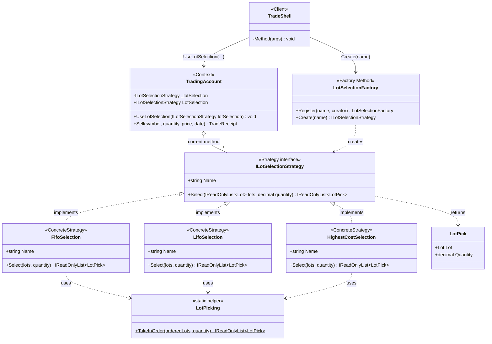
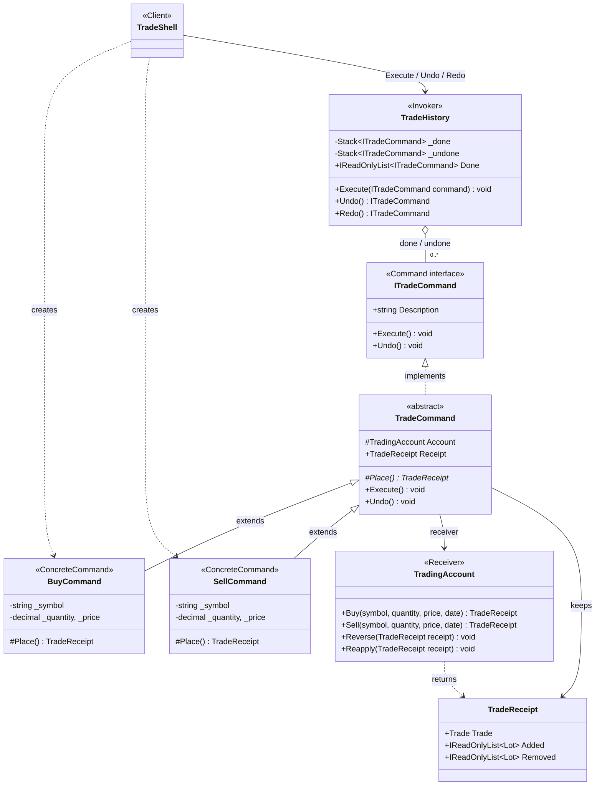
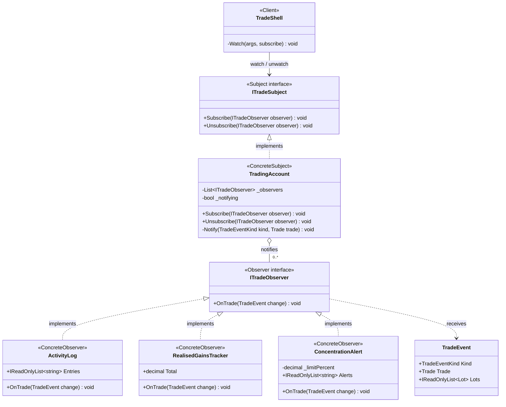
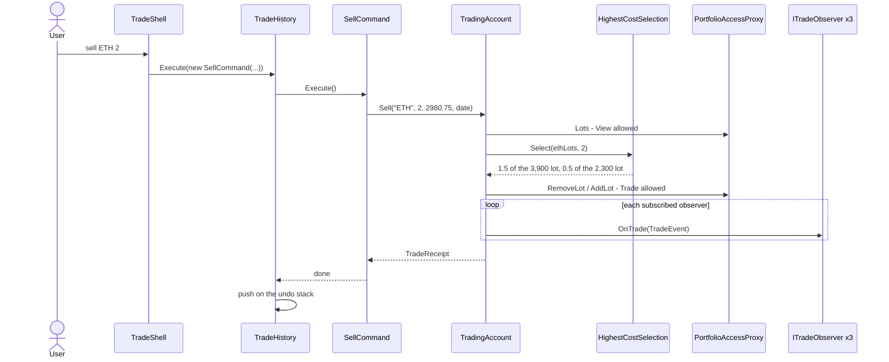

# Laboratory Work No. 4 — Behavioral Design Patterns

**Student:** Adrian Mutu, group FAF-242
**Course:** Software Design Techniques and Mechanisms (TMPS) — FCIM, Technical University of Moldova
**Checked by:** Daniel Istrati
**Implementation:** C# 14 on .NET 10 · tests: xUnit v3 · code: [`src/WealthTracker`](src/WealthTracker)

## 1. Domain description

The project continues the **Personal Wealth Dashboard & Multi-Asset Portfolio Tracker** from Laboratory Works 1–3. It records a person's investments — stocks, ETFs, cryptocurrencies and cash — as dated **purchase lots**, values them at current prices and produces holdings, allocation and performance reports. Lab 3 added the structural side: shared instrument data (Flyweight), an advisor's read-only access (Proxy) and reports in any format (Bridge).

Lab 4 adds **trading**: the user records purchases and sales, and the tracker keeps the portfolio, the realised gains and the risk picture up to date. Three needs of this feature are behavioral design problems:

| Need | Why it is a problem without a pattern | Pattern |
|---|---|---|
| Selling *part* of a holding that was bought in several lots at different prices: which lots are sold? FIFO, LIFO and highest-cost-first give different taxable gains, and the user must be able to choose | an `if/else` on a method name inside the sale; every new method would edit the sale code | **Strategy** |
| A mistyped trade must be undoable, and an undone one redoable — including a sale that split a lot | without an object per trade there is nothing to undo; reversing a sale by "buying back" would invent new lots with the wrong cost and date | **Command** |
| After each trade several independent parts of the app must react: an activity log, the realised-gains total (for tax), a concentration alert | the account would have to call each of them by name and be edited for every new reaction | **Observer** |

The behavioral patterns work on the objects the earlier labs built: the portfolio comes from the **Builder** (Lab 2), its instruments are **Flyweights**, every change passes through the owner's **Proxy**, and the result is printed with a **Bridge** report (Lab 3). Strategies are created by name through a parameterised **Factory Method**, like the renderers (§4).

### Requirements checklist

| Requirement | Where it is met |
|---|---|
| 1. Three behavioral patterns with full structure | Strategy §2.1 (context, interface, 3 concrete strategies), Command §2.2 (command interface, 2 concrete commands, receiver, invoker with undo/redo, client), Observer §2.3 (subject, observer interface, 3 concrete observers that subscribe and unsubscribe at runtime) |
| 2. Patterns interact | §3: `sell ETH 2` is a **Command** whose receiver asks the **Strategy** for lots and announces the result to the **Observers**; covered by `InteractionTests` |
| 3. Client depends on abstractions | `TradeHistory` knows only `ITradeCommand`; `TradingAccount` only `ILotSelectionStrategy`, `ITradeObserver` and `IPortfolio`; `TradeShell` looks strategies and observers up by name |
| 4. Open for extension | a new strategy, command or observer is a new class only — proven by `NewMethod_PlugsIn_…`, `History_RunsAnyITradeCommand` and the spy observers in the tests |
| 5. Build on the previous lab | Lab 3's Flyweight, Proxy and Bridge, and Lab 2's Builder and Factory Method are used by the new code (§4) |
| 6. Clean project structure | `Domain/`, `Patterns/<Pattern>/`, `Creational/`, `Client/` (§5) |
| 7. Runnable demo | `dotnet run --project src/WealthTracker` — output in [`docs/demo-output.txt`](docs/demo-output.txt) |
| A. Behavior changes at runtime | in `dotnet run --project src/WealthTracker -- shell` the user types `method lifo` to switch the strategy, `watch`/`unwatch` to subscribe and unsubscribe observers, `undo`/`redo` to move through the command history |
| B. At least 2 tests per pattern | Strategy 11 (9 methods), Command 7, Observer 7, plus 6 interaction tests; with the 28 Flyweight, Proxy, Bridge and creational tests kept from Lab 3 — 59 in total, `dotnet test` |

## 2. Patterns

### 2.1 Strategy — which lots a sale uses

**Problem.** The demo portfolio holds ETH bought three times: 4.2 at 1,850 (2023), 1.5 at 3,900 (March 2024) and 2.0 at 2,300 (August 2024). Selling 2 ETH at 2,980.75 can take the units from any of these lots, and the choice decides the realised gain that is taxed: **+2,261.50** under FIFO, **+1,361.50** under LIFO, **−1,038.50** (a deductible loss) under highest-cost-first. Brokers let the investor choose the method, and the choice may change between sales. Writing the three rules as branches of the sale would mix them with the trading code and make every new method an edit of that code.

**Roles.** `ILotSelectionStrategy` is the **Strategy** interface: given the lots of one instrument and a quantity, it returns the `LotPick`s — which lot and how many units. `FifoSelection`, `LifoSelection` and `HighestCostSelection` are the **ConcreteStrategies**; each orders the lots differently and hands them to the shared helper `LotPicking.TakeInOrder`. `TradingAccount` is the **Context**: it holds the current strategy, calls it in `Sell` and can swap it at runtime (`UseLotSelection`). The `TradeShell` client never names a concrete class — `method hifo` goes through `LotSelectionFactory`.

<!-- figure: strategy -->

*Figure 1 — Strategy in the project: the account delegates the choice of lots to the current method.*

**Code** — the context delegating to its strategy, [`TradingAccount.cs`, lines 72–97](src/WealthTracker/Domain/TradingAccount.cs#L72-L97):

```csharp
        var lots = LotsOf(symbol);
        var held = lots.Sum(lot => lot.Quantity);
        if (quantity > held)
            throw new InvalidOperationException(
                FormattableString.Invariant($"Cannot sell {quantity} {symbol.ToUpperInvariant()}: only {held} held."));

        // The strategy decides which lots; the account carries the sale out.
        var picks = _lotSelection.Select(lots, quantity);
        if (picks.Sum(p => p.Quantity) != quantity || picks.Any(p => !lots.Contains(p.Lot)))
            throw new InvalidOperationException(
                FormattableString.Invariant($"{_lotSelection.Name} did not pick {quantity} units from the held lots."));

        var removed = picks.Select(p => p.Lot).ToList();
        var added = picks.Where(p => p.Quantity < p.Lot.Quantity)   // the unsold rest of a split lot
                         .Select(p => new Lot(p.Lot.Instrument, p.Lot.Quantity - p.Quantity,
                                              p.Lot.UnitCost, p.Lot.Purchased))
                         .ToList();
        Apply(remove: removed, add: added);

        var trade = new Trade(TradeSide.Sell, lots[0].Instrument, quantity, price, date)
        {
            Picks = picks,
            Method = _lotSelection.Name,
        };
        Notify(TradeEventKind.Executed, trade);
        return new TradeReceipt(trade, added, removed);
```

The only line that depends on the method is `_lotSelection.Select(lots, quantity)`: the account does not know whether it holds FIFO, LIFO or HIFO, and `UseLotSelection` replaces the object between two sales. A concrete strategy is a single ordering rule — FIFO is `LotPicking.TakeInOrder(lots.OrderBy(lot => lot.Purchased), quantity)` — and the account checks whatever a strategy returns before applying it.

**Tests.** [`StrategyTests.cs`](tests/WealthTracker.Tests/StrategyTests.cs)

| Test | What it proves |
|---|---|
| `Fifo_SellsTheOldestLotFirst` | 2 ETH come from the 2023 lot |
| `Lifo_SellsTheNewestLotFirst` | 2 ETH come from the August 2024 lot |
| `HighestCost_SellsTheMostExpensiveLotsFirst` | 1.5 from the 3,900 lot, then 0.5 from the 2,300 lot |
| `SameSale_RealisesADifferentGain_UnderEachMethod` (3 cases) | the same sale realises +2,261.50, +1,361.50 and −1,038.50 under `fifo`, `lifo`, `hifo` created by name |
| `SwitchingTheMethodAtRuntime_ChangesWhichLotsTheNextSaleUses` | on one account, a sale under FIFO takes the oldest lot; after `UseLotSelection(new LifoSelection())` the next sale takes the newest |
| `Sale_SpansLots_AndKeepsTheUnsoldRestAtItsOriginalCostAndDate` | a sale across two lots removes both and keeps 0.7 ETH at 3,900 dated 2024-03-11 |
| `SellingMoreThanHeld_Throws_AndChangesNothing` | an impossible sale is rejected before any lot changes |
| `NewMethod_PlugsIn_WithoutChangingTheAccountOrTheFactory` | a `LargestLotFirst` strategy written only in the test is registered and used |
| `LotSelectionFactory_UnknownMethod_ListsTheKnownOnes` | a mistyped name is rejected with the list `fifo, hifo, lifo` |

Log of `dotnet test --output Detailed` for `StrategyTests` (full log: [`docs/test-results.txt`](docs/test-results.txt)):

```text
passed StrategyTests.NewMethod_PlugsIn_WithoutChangingTheAccountOrTheFactory (19ms)
passed StrategyTests.Sale_SpansLots_AndKeepsTheUnsoldRestAtItsOriginalCostAndDate (1ms)
passed StrategyTests.SameSale_RealisesADifferentGain_UnderEachMethod(method: "lifo", expectedGain: "1361.50") (0ms)
passed StrategyTests.SameSale_RealisesADifferentGain_UnderEachMethod(method: "fifo", expectedGain: "2261.50") (0ms)
passed StrategyTests.SameSale_RealisesADifferentGain_UnderEachMethod(method: "hifo", expectedGain: "-1038.50") (0ms)
passed StrategyTests.LotSelectionFactory_UnknownMethod_ListsTheKnownOnes (0ms)
passed StrategyTests.HighestCost_SellsTheMostExpensiveLotsFirst (0ms)
passed StrategyTests.Lifo_SellsTheNewestLotFirst (0ms)
passed StrategyTests.SellingMoreThanHeld_Throws_AndChangesNothing (0ms)
passed StrategyTests.SwitchingTheMethodAtRuntime_ChangesWhichLotsTheNextSaleUses (0ms)
passed StrategyTests.Fifo_SellsTheOldestLotFirst (0ms)
11 passed, 0 failed
```

### 2.2 Command — trades with undo and redo

**Problem.** Trades are typed by hand, and a wrong quantity or price must be undoable; an undone trade should be redoable. Undo is not trivial: a sale of 5 ETH under FIFO removes the 4.2 lot, removes the 1.5 lot and adds back an unsold rest of 0.7. "Buying back" 5 ETH would create a new lot with today's date and price — the cost basis, and therefore every later tax figure, would be wrong. To undo exactly, each trade has to be an object that remembers what it changed.

**Roles.** `ITradeCommand` is the **Command** interface (`Execute`, `Undo`, `Description`). `BuyCommand` and `SellCommand` are the **ConcreteCommands**; they share the abstract `TradeCommand`, which keeps the receiver and the `TradeReceipt` of the first run. `TradingAccount` is the **Receiver**: the trading rules — validation, the strategy call, splitting lots — live in its `Buy`/`Sell`, and `Reverse`/`Reapply` apply a receipt backwards or forwards. `TradeHistory` is the **Invoker**: two stacks, `Execute`, `Undo`, `Redo`, and it knows only `ITradeCommand`. `TradeShell` is the **Client** that turns `sell ETH 2` into a `SellCommand`.

<!-- figure: command -->

*Figure 2 — Command in the project: the history runs commands; commands call the account and keep its receipt.*

**Code** — the execute/undo pair, [`TradeCommand.cs`, lines 30–49](src/WealthTracker/Patterns/Command/TradeCommand.cs#L30-L49):

```csharp
    protected abstract TradeReceipt Place();

    public void Execute()
    {
        if (_executed)
            throw new InvalidOperationException($"'{Description}' has already been executed.");
        if (Receipt is null)
            Receipt = Place();               // first run: the account applies its rules
        else
            Account.Reapply(Receipt);        // redo: the very same lots again
        _executed = true;
    }

    public void Undo()
    {
        if (!_executed || Receipt is null)
            throw new InvalidOperationException($"'{Description}' has not been executed.");
        Account.Reverse(Receipt);
        _executed = false;
    }
```

The command holds no trading logic: `Place()` is `Account.Buy(...)` in `BuyCommand` and `Account.Sell(...)` in `SellCommand`. What it adds is memory — the receipt lists the exact lot objects added and removed, and since lots are immutable, applying it backwards restores the previous portfolio and applying it forwards redoes the trade with the same lots, even if the lot-selection method was switched in between. The invoker, [`TradeHistory.cs`, lines 18–34](src/WealthTracker/Patterns/Command/TradeHistory.cs#L18-L34):

```csharp
    public void Execute(ITradeCommand command)
    {
        ArgumentNullException.ThrowIfNull(command);
        command.Execute();   // if this throws, nothing is recorded
        _done.Push(command);
        _undone.Clear();     // a new action ends the old redo branch
    }

    public ITradeCommand Undo()
    {
        if (!CanUndo)
            throw new InvalidOperationException("Nothing to undo.");
        var command = _done.Peek();
        command.Undo();      // only moved to the redo stack if the undo succeeded
        _undone.Push(_done.Pop());
        return command;
    }
```

**Tests.** [`CommandTests.cs`](tests/WealthTracker.Tests/CommandTests.cs)

| Test | What it proves |
|---|---|
| `BuyThenUndo_RestoresTheOriginalLots` | after buy + undo the portfolio holds exactly the original lot objects |
| `SellThenUndo_PutsBackEveryLot_AndDropsTheSplitRest` | a FIFO sale of 5 ETH across two lots, then undo: every original lot is back, the 0.7 rest is gone, 7.7 ETH again |
| `Redo_ReappliesTheSameLots_EvenIfTheMethodChangedInBetween` | sell under FIFO, undo, switch to LIFO, redo: the portfolio matches the first FIFO run |
| `NewCommandAfterUndo_ClearsTheRedoStack` | a new trade after an undo ends the redo branch |
| `FailedCommand_IsNotRecorded_AndChangesNothing` | selling 100 ETH throws; the history stays empty and no lot changes |
| `Undo_WithNothingDone_Throws` | undo and redo on an empty history are rejected |
| `History_RunsAnyITradeCommand` | a `CountingCommand` written only in the test is executed, undone and redone by the invoker |

Log of `dotnet test --output Detailed` for `CommandTests`:

```text
passed CommandTests.Redo_ReappliesTheSameLots_EvenIfTheMethodChangedInBetween (10ms)
passed CommandTests.NewCommandAfterUndo_ClearsTheRedoStack (6ms)
passed CommandTests.SellThenUndo_PutsBackEveryLot_AndDropsTheSplitRest (1ms)
passed CommandTests.History_RunsAnyITradeCommand (0ms)
passed CommandTests.BuyThenUndo_RestoresTheOriginalLots (0ms)
passed CommandTests.Undo_WithNothingDone_Throws (0ms)
passed CommandTests.FailedCommand_IsNotRecorded_AndChangesNothing (0ms)
7 passed, 0 failed
```

### 2.3 Observer — reacting to every trade

**Problem.** Each trade, undo and redo must update several things that have nothing to do with each other: a readable activity log, the running total of realised gains (what is taxed this year) and a warning when one instrument becomes too large a share of the portfolio. If the account called them directly it would depend on all of them and change whenever a reaction is added; the user also wants to turn some of them off while working.

**Roles.** `ITradeSubject` is the **Subject** interface (`Subscribe`, `Unsubscribe`) and `TradingAccount` the **ConcreteSubject**: it keeps a list of `ITradeObserver`s and notifies them after every change. `ITradeObserver` is the **Observer** interface with one method, `OnTrade(TradeEvent)`. `ActivityLog`, `RealisedGainsTracker` and `ConcentrationAlert` are the **ConcreteObservers**. `TradeEvent` carries the trade, whether it was executed or reversed, and a read-only view of the lots after the change. In the shell the user subscribes and unsubscribes them with `watch` and `unwatch`.

<!-- figure: observer -->

*Figure 3 — Observer in the project: the account announces trades to whoever is subscribed.*

**Code** — the subject's notify loop, [`TradingAccount.cs`, lines 132–146](src/WealthTracker/Domain/TradingAccount.cs#L132-L146), and one observer, [`RealisedGainsTracker.cs`, lines 21–28](src/WealthTracker/Patterns/Observer/RealisedGainsTracker.cs#L21-L28):

```csharp
    private void Notify(TradeEventKind kind, Trade trade)
    {
        var change = new TradeEvent(kind, trade, _portfolio.Lots);
        _notifying = true;
        try
        {
            // A copy, so an observer may unsubscribe while it is being notified.
            foreach (var observer in _observers.ToArray())
                observer.OnTrade(change);
        }
        finally
        {
            _notifying = false;
        }
    }

    // RealisedGainsTracker
    public void OnTrade(TradeEvent change)
    {
        if (change.Trade.Side != TradeSide.Sell)
            return;
        var gain = change.Kind == TradeEventKind.Executed ? change.Trade.RealisedGain : -change.Trade.RealisedGain;
        Total += gain;
        _output.WriteLine($"  [gains]  {Formats.SignedMoney(gain)} realised, total {Formats.SignedMoney(Total)}");
    }
```

The subject only loops over `ITradeObserver`; it never names a concrete observer. Two details keep the loop safe: it iterates over a copy, so an observer may unsubscribe itself, and `_notifying` makes any attempt to trade from inside a notification fail at once instead of starting an endless chain of notifications. Because undo is announced too (`Reversed`), the gains total stays correct after any sequence of undo and redo.

**Tests.** [`ObserverTests.cs`](tests/WealthTracker.Tests/ObserverTests.cs)

| Test | What it proves |
|---|---|
| `EverySubscribedObserver_IsNotified` | two spies each receive one `Executed` buy event that shows the portfolio after the change |
| `UnsubscribedObserver_IsNotNotified_TheOthersStillAre` | after `Unsubscribe` at runtime one spy stops receiving events, the other keeps receiving them |
| `SubscribingTwice_StillNotifiesOnce` | a double subscription does not double the notifications |
| `UndoIsAnnounced_SoRealisedGainsGoBackToZero` | sell (+2,261.50) then undo through the history: the tracker is back to 0 |
| `ConcentrationAlert_FiresOnlyAboveTheLimit` | with a 50% limit, buying AAPL (~8%) is silent and buying ETH (~92%) raises one alert |
| `ActivityLog_ShowsTheLotsTheStrategyChose` | the log lists the sale with "FIFO: 2 from 2023-03-12 @ 1,850.00" and then the same line as "UNDONE" |
| `ObserverThatTrades_IsStopped_InsteadOfLoopingForever` | an observer that buys on every notification is stopped after one call |

Log of `dotnet test --output Detailed` for `ObserverTests`:

```text
passed ObserverTests.ObserverThatTrades_IsStopped_InsteadOfLoopingForever (10ms)
passed ObserverTests.SubscribingTwice_StillNotifiesOnce (0ms)
passed ObserverTests.UnsubscribedObserver_IsNotNotified_TheOthersStillAre (0ms)
passed ObserverTests.ActivityLog_ShowsTheLotsTheStrategyChose (12ms)
passed ObserverTests.UndoIsAnnounced_SoRealisedGainsGoBackToZero (0ms)
passed ObserverTests.EverySubscribedObserver_IsNotified (1ms)
passed ObserverTests.ConcentrationAlert_FiresOnlyAboveTheLimit (0ms)
7 passed, 0 failed
```

## 3. How the patterns interact

One typed line, `sell ETH 2`, passes through all three behavioral patterns and two structural ones. The shell creates a **Command** and gives it to the history; the command asks its receiver, the account, to sell; the account asks the current **Strategy** which lots to use and changes the portfolio through the owner's **Proxy**; then it announces the trade to the **Observers**. Undo travels the same way backwards and is announced as well.

<!-- figure: interaction -->

*Figure 4 — One typed command through Command, Strategy, Proxy and Observer.*

The same path decides what happens when something fails. When the advisor types `sell ETH 1`, the command reaches the account and the strategy picks a lot, but the advisor's Proxy refuses the first `RemoveLot`: the exception leaves the portfolio untouched, the history does not record the command and the observers are never told about a trade that did not happen.

| Test | What it proves |
|---|---|
| `SellCommand_AsksTheStrategy_ThenAnnouncesTheResult` | a `SellCommand` under HIFO realises −1,038.50 in the gains observer and logs the two chosen lots; the history can undo it |
| `AdvisorSellCommand_IsRefusedByTheProxy_NotRecorded_AndNotAnnounced` | through the advisor's proxy the command throws `AccessDeniedException`; history empty, log empty, 4 lots unchanged |
| `TypedCommands_SwitchTheStrategyAndTheObservers_WhileTheProgramRuns` | a typed session (`watch`, `method hifo`, `sell`, `unwatch log`, `undo`, a mistyped method, `quit`) changes behaviour exactly as typed and stops at `quit` |
| `ConsoleDemo_RunsEverySection` | the scripted demo runs every section without an error |
| `AdvisorReport_GoesThroughProxy_Bridge_AndSharedInstruments` | (Lab 3) the advisor's report goes Proxy → Bridge → Flyweight |
| `Advisor_CannotTrade_OnTheSamePath` | (Lab 3) the advisor cannot remove a lot |

Log of `dotnet test --output Detailed` for `InteractionTests`:

```text
passed InteractionTests.Advisor_CannotTrade_OnTheSamePath (10ms)
passed InteractionTests.SellCommand_AsksTheStrategy_ThenAnnouncesTheResult (12ms)
passed InteractionTests.TypedCommands_SwitchTheStrategyAndTheObservers_WhileTheProgramRuns (1ms)
passed InteractionTests.ConsoleDemo_RunsEverySection (1ms)
passed InteractionTests.AdvisorSellCommand_IsRefusedByTheProxy_NotRecorded_AndNotAnnounced (0ms)
passed InteractionTests.AdvisorReport_GoesThroughProxy_Bridge_AndSharedInstruments (0ms)
6 passed, 0 failed
```

**Behavior changed at runtime.**

The demo is played through the same `TradeShell` a user types into, so every behavior change in it is driven by input: the same sale under three methods switched while the program runs, then an observer unsubscribed and subscribed again.

Sections 3 and 4 of [`docs/demo-output.txt`](docs/demo-output.txt):

```text
=== 3. Strategy: the same sale under FIFO, LIFO and HIFO ===
> sell ETH 2
  [log]    SELL 2 ETH @ 2,980.75 on 2026-11-26 - FIFO: 2 from 2023-03-12 @ 1,850.00
  [gains]  +2,261.50 realised, total +2,261.50
> undo
  [log]    UNDONE SELL 2 ETH @ 2,980.75 on 2026-11-26 - FIFO: 2 from 2023-03-12 @ 1,850.00
  [gains]  -2,261.50 realised, total 0.00
  [alert]  ETH is 35.23% of the portfolio, above the 35% limit
> method lifo
  lot selection: LIFO   (known: fifo, hifo, lifo)
> sell ETH 2
  [log]    SELL 2 ETH @ 2,980.75 on 2026-11-26 - LIFO: 2 from 2024-08-05 @ 2,300.00
  [gains]  +1,361.50 realised, total +1,361.50
> undo
  [log]    UNDONE SELL 2 ETH @ 2,980.75 on 2026-11-26 - LIFO: 2 from 2024-08-05 @ 2,300.00
  [gains]  -1,361.50 realised, total 0.00
  [alert]  ETH is 35.23% of the portfolio, above the 35% limit
> method hifo
  lot selection: HIFO   (known: fifo, hifo, lifo)
> sell ETH 2
  [log]    SELL 2 ETH @ 2,980.75 on 2026-11-26 - HIFO: 1.5 from 2024-03-11 @ 3,900.00, 0.5 from 2024-08-05 @ 2,300.00
  [gains]  -1,038.50 realised, total -1,038.50

=== 4. Observer: subscribing and unsubscribing at runtime ===
> unwatch log
  watching: gains, alerts
> sell AAPL 2
  [gains]  +58.60 realised, total -979.90
> watch log
  watching: log, gains, alerts
> buy VWCE 2
  [log]    BUY 2 VWCE @ 118.40 on 2026-11-26
```

## 4. Patterns reused from Labs 2 and 3

| Pattern | Lab | How the behavioral code uses it |
|---|---|---|
| **Builder** + Director | 2 | `PortfolioDirector` builds the 43-lot portfolio the account trades on |
| **Factory Method** (parameterised) | 2 | the new `LotSelectionFactory` turns `fifo`/`lifo`/`hifo` into strategies, exactly like `RendererFactory` turns format names into renderers |
| **Flyweight** | 3 | `TradingAccount.Buy` takes the instrument from `InstrumentFactory`, so a bought lot shares the instrument object of the existing ones; the concentration alert finds the traded holding by that shared reference |
| **Proxy** | 3 | the account works on `IPortfolio`; the owner trades through a `PortfolioAccessProxy`, and the advisor's proxy refuses trades on the same path (§3) |
| **Bridge** | 3 | the shell's `holdings` command prints a `HoldingsReport` with a `ConsoleTableRenderer` |

The Lab 3 tests (Flyweight 7, Proxy 6, Bridge 11, Creational 4, Interaction 2) still run unchanged except for one: the proxy's log text changed from "buy 3 AAPL" to "add a lot of 3 AAPL", because a lot is now also added when a sale is undone or leaves a rest.

## 5. Project structure and how to run

```
Lab4/
├── WealthTracker.slnx            solution
├── src/WealthTracker/
│   ├── Program.cs                entry point: demo, or "shell" for typed commands
│   ├── Client/                   ConsoleDemo, TradeShell, FlyweightMeasurement
│   ├── Domain/                   Lot, Portfolio, TradingAccount, Trade, TradeReceipt, LotPick, ...
│   ├── Patterns/Strategy/        ILotSelectionStrategy, Fifo/Lifo/HighestCostSelection, LotPicking
│   ├── Patterns/Command/         ITradeCommand, TradeCommand, BuyCommand, SellCommand, TradeHistory
│   ├── Patterns/Observer/        ITradeSubject, ITradeObserver, TradeEvent, 3 observers
│   ├── Patterns/Flyweight/       (Lab 3)
│   ├── Patterns/Proxy/           (Lab 3)
│   ├── Patterns/Bridge/          (Lab 3)
│   └── Creational/               PortfolioBuilder, PortfolioDirector, RendererFactory, LotSelectionFactory
└── tests/WealthTracker.Tests/    59 tests, one class per pattern
```

```bash
dotnet run --project src/WealthTracker            # scripted demo of every pattern
dotnet run --project src/WealthTracker -- shell   # type the commands yourself
dotnet test                                       # all 59 tests, one command
```

## 6. The behavioral patterns not implemented

The assignment asks to study the other patterns too. For each one: what it is for, where it would fit in this project and why it was not chosen.

| Pattern | Intent | Where it would fit here | Why not here |
|---|---|---|---|
| **Chain of Responsibility** | pass a request along handlers until one handles it | validating an order: a chain of checks (market open, enough cash, position limit, compliance) where each may reject the order or pass it on | the project has only two simple checks, so a chain would be forced; it is the natural next step if order validation grows |
| **Iterator** | traverse a collection without exposing its structure | walking lots in tax order, or the trades of one year | C# `IEnumerable` and LINQ already are the iterator; a hand-written one would only wrap a built-in loop — a listed mistake |
| **Mediator** | objects communicate through a central mediator | a GUI dashboard where the account selector, the chart and the report panel must update each other | there are no colleague objects talking to each other in a console app |
| **Memento** | capture and restore an object's state without breaking encapsulation | undo by snapshotting the whole portfolio before each trade | Command with receipts undoes a trade by its delta; a full snapshot per trade would copy hundreds of lots each time. A `TradeReceipt` is close in spirit, but it records a change, not a state |
| **State** | an object's behaviour changes with its internal state | an order's life cycle: draft → submitted → filled / cancelled, with different allowed actions in each state | trades here are recorded after they happened, so they have no life cycle; with live orders, State would replace a status `switch` |
| **Template Method** | a fixed algorithm skeleton with overridable steps | `TradeCommand.Execute` already has this shape: the base fixes "first run or redo, then mark executed" and subclasses supply only `Place()` | used here only to remove duplication between the two commands, so it is not counted as one of the three patterns |
| **Visitor** | add operations to a stable class hierarchy without changing it | tax and fee calculations over asset classes (stock, ETF, crypto, cash) treated differently | instruments are one class with an `AssetClass` value, not a class hierarchy, so there is nothing to double-dispatch on |
| **Interpreter** (good to know) | a grammar and an evaluator for a small language | alert rules such as `ETH > 35% or BTC < 20000` typed by the user | the shell's fixed verbs are enough; a rule language would be the place to use it |

## 7. Conclusions

**What was harder than expected.**

- **Undoing a sale correctly.** The first idea — undo a sale by buying the same quantity back — gives the right *quantity* but the wrong cost basis and dates, and every later FIFO sale and tax figure would be wrong. The solution was the `TradeReceipt`: the receiver returns the exact lot objects it removed and added, and because `Lot` is immutable, putting the same objects back restores the portfolio exactly. This also made the split lot (the unsold 0.7 ETH of a 1.5 lot) undo cleanly.
- **Redo after the strategy changed.** If redo simply ran `Sell` again, a user who undoes a FIFO sale, switches to LIFO and presses redo would get a different sale than the one undone. Redo now replays the receipt instead of re-running the rules, and a test (`Redo_ReappliesTheSameLots_…`) pins this down.
- **Keeping logic in the receiver.** It was tempting to let `SellCommand` call the strategy and split lots itself; that would have made the commands the place of the business logic, which the assignment lists as a Command mistake. The commands now only remember what to call and the receipt.
- **Making observers safe.** Passing the whole `IPortfolio` to observers would have let an observer change the portfolio while being notified; an observer that trades would trigger notifications forever. Observers now get a read-only view of the lots, and a guard stops trading from inside a notification.
- **A locale bug.** On a Romanian system the proxy's message read "4,2 ETH", because string interpolation uses the current culture. All user-facing numbers now use the invariant culture.

**What I would design differently.**

- **`TradingAccount` plays three roles** — strategy context, command receiver and observer subject. At about 150 lines it is still focused on one thing (changing the portfolio), but if it grows the subject part should move to a separate `TradeNotifier` that the account owns.
- **Observers print their own lines.** `ActivityLog` and the others write to a `TextWriter`, which mixes presentation into the observers. They should produce messages and let the client decide how to show them.
- **The concentration alert repeats.** It warns after every trade while the share is above the limit; firing only when the limit is *crossed* would be less noisy.
- **No real transactions.** A sale is applied lot by lot; today the only failure is the proxy refusing the first change, so nothing is left half-done, but a persistent store would need a proper unit of work. The history also lives only in memory.
